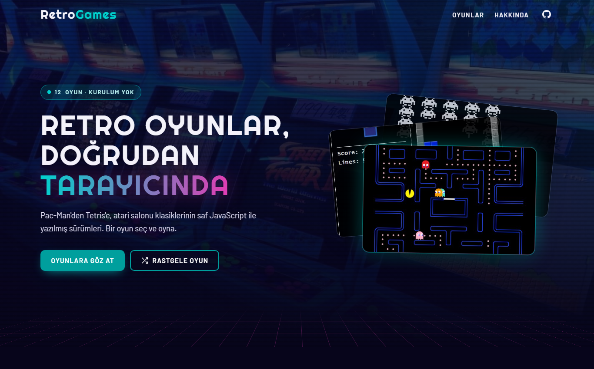
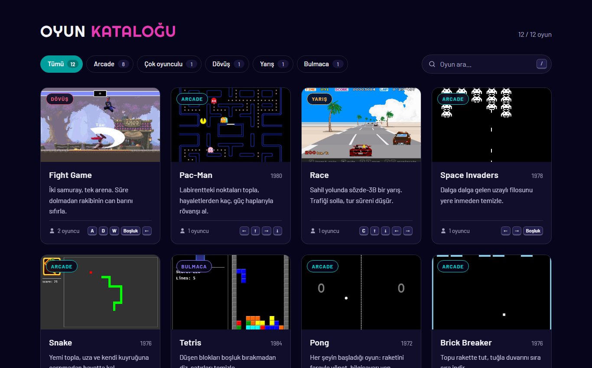
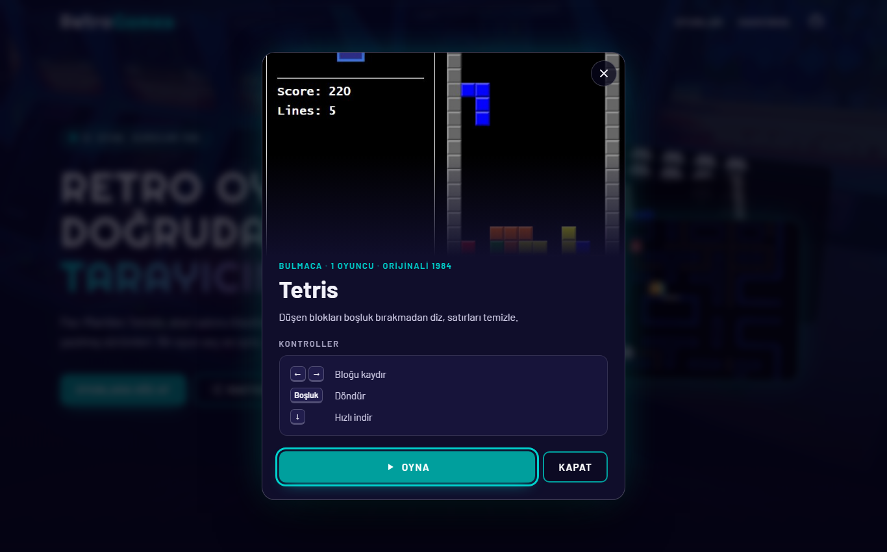

# RetroGames

Klasik atari oyunlarını tek bir çatı altında toplayan, tarayıcıda çalışan statik oyun portalı. 12 oyun, saf JavaScript; derleme adımı, framework ve sunucu tarafı yok.

> Bu depo, [alicmn/game-website](https://github.com/alicmn/game-website) projesinin çatalıdır (fork). Oyunlar orijinal projeden gelir; bu çatalda ana sayfa baştan tasarlandı ve oyunlarda iyileştirmeler yapıldı. Ayrıntılar için [Çatal bilgisi](#çatal-bilgisi-ve-yapılan-değişiklikler) bölümüne bakın.

**Canlı demo:** [pietro379.github.io/game-website](https://pietro379.github.io/game-website/)



| Oyun kataloğu | Oyun detayı |
| --- | --- |
|  |  |

## Özellikler

- 12 oynanabilir oyun, tek bir katalogdan erişim
- Türe göre filtreleme (sayaçlı) ve anlık arama; `/` ile aramaya odaklan, `Esc` ile temizle
- Oyun detay penceresi: açıklama, tür, orijinal çıkış yılı ve tuş rozetleriyle kontroller
- Paylaşılabilir bağlantılar: `index.html#tetris` doğrudan oyunun detayını açar
- "Kaldığın yerden devam et": son oynanan oyunlar tarayıcıda (`localStorage`) hatırlanır
- Dokunmatik cihazlarda klavye gerektiren oyunlar için uyarı
- Veri odaklı katalog: yeni oyun eklemek için `js/games.js` içine tek kayıt yeterli
- Mobil uyumlu, klavyeyle gezilebilir, `prefers-reduced-motion` destekli arayüz
- Her oyun sayfasında ortak üst bar: ana sayfaya dönüş ve tam ekran

## Oyunlar

| Oyun | Tür | Oyuncu | Kontroller |
| --- | --- | --- | --- |
| Fight Game | Dövüş | 2 | A/D/W + Boşluk · Ok tuşları + ↓ |
| Pac-Man | Arcade | 1 | Ok tuşları |
| Race | Yarış | 1 | Ok tuşları, C ile başla, M ile sessiz |
| Space Invaders | Arcade | 1 | ← → ve Boşluk |
| Snake | Arcade | 1 | Ok tuşları |
| Tetris | Bulmaca | 1 | ← → · Boşluk ile döndür · ↓ hızlı indir |
| Pong | Arcade | 1 | Fare |
| Brick Breaker | Arcade | 1 | ← →, Boşluk ile yeniden başla |
| XOX | Çok oyunculu | 2 | Fare |
| Köstebeği Yakala | Arcade | 1 | Fare |
| Flappy Bird | Arcade | 1 | Enter ile başla, Boşluk |
| Doodle Jump | Arcade | 1 | ← → (veya A/D), Boşluk ile yeniden başla |

## Çalıştırma

Kurulum gerekmez. Depoyu klonlayıp `index.html` dosyasını tarayıcıda açın:

```bash
git clone https://github.com/pietro379/game-website.git
cd game-website
```

Yerel bir sunucu üzerinden çalıştırmak isterseniz (Node.js gerekir):

```bash
npm start
```

Proje tamamen statik olduğu için GitHub Pages veya Vercel üzerinde ek ayar olmadan yayınlanabilir.

## Proje yapısı

```
.
├── index.html          Ana sayfa
├── css/style.css       Ana sayfa stilleri
├── js/
│   ├── games.js        Oyun kataloğu verisi
│   └── main.js         Filtreleme, arama, kartlar, detay penceresi, son oynananlar
├── assets/             Görseller ve favicon
├── Games/              Her oyun kendi klasöründe, bağımsız çalışır
│   └── shared/back.js  Oyun sayfalarındaki ortak üst bar (ana sayfa + tam ekran)
└── docs/               README ekran görüntüleri
```

## Yeni oyun ekleme

1. Oyunu `Games/<Klasor_Adi>/index.html` olarak ekleyin.
2. `<head>` içine `<script src="../shared/back.js" defer></script>` satırını koyun.
3. `assets/images/games/<slug>.jpg` olarak bir kapak görseli ekleyin.
4. `js/games.js` içindeki `GAMES` listesine kaydı ekleyin (`controls` alanı detay penceresindeki tuş rozetlerini üretir).

## Teknolojiler

HTML5 (`<dialog>`), CSS3 (özel değişkenler, grid, `backdrop-filter`), JavaScript (ES2020), Canvas API, Web Storage ve Fullscreen API. Pac-Man oyunu jQuery, Fight Game ise GSAP kullanır.

## Çatal bilgisi ve yapılan değişiklikler

Orijinal depo, 12 oyunu Bootstrap/Tailwind tabanlı bir giriş sayfasında topluyordu; `node_modules` ve `dist` klasörleri de depoya dahildi. Bu çatalda yapılanlar:

- **Ana sayfa baştan yazıldı:** veri odaklı oyun kataloğu, sayaçlı tür filtreleri, anlık arama, oyun detay penceresi (tür, orijinal çıkış yılı, kontroller), paylaşılabilir bağlantılar (`#tetris`) ve "kaldığın yerden devam et" listesi. Framework kullanılmadı.
- **Ortak üst bar:** her oyun sayfasına ana sayfaya dönüş ve tam ekran düğmesi eklendi, sayfa başlıkları düzenlendi.
- **Hata düzeltmeleri:** Fight Game'de tuşlar Caps Lock açıkken de çalışıyor; Tetris'te eksik CSS birimleri tamamlandı.
- **Depo düzeni:** `node_modules` ve `dist` takip dışı bırakıldı, kullanılmayan dosyalar temizlendi, ekran görüntüleriyle yeni bir README yazıldı.
- **Erişilebilirlik ve duyarlılık:** klavyeyle gezilebilir arayüz, mobil uyum ve `prefers-reduced-motion` desteği.

## Kaynaklar ve lisans

Oyunların bir kısmı açık kaynak projelerden ve eğitim içeriklerinden uyarlanmıştır:

- **Pac-Man**: Lucio Panepinto'nun HTML5 Pac-Man projesi, GPLv3 (`Games/PacMan_Game/LICENSE.txt`).
- **Snake**: Kenny Yip'in Snake eğitimi temel alınmıştır.
- **Race**: CodePen'de yayınlanmış bir sözde-3B yarış demosu temel alınmıştır; ses dosyaları CodePen'in varlık sunucusundan yüklenir.
- **Orijinal proje**: [alicmn/game-website](https://github.com/alicmn/game-website) (12 oyunun bir arada sunulduğu ilk sürüm).

Oyun adları ve karakterleri ilgili hak sahiplerine aittir; bu proje eğitim ve portföy amaçlıdır.
